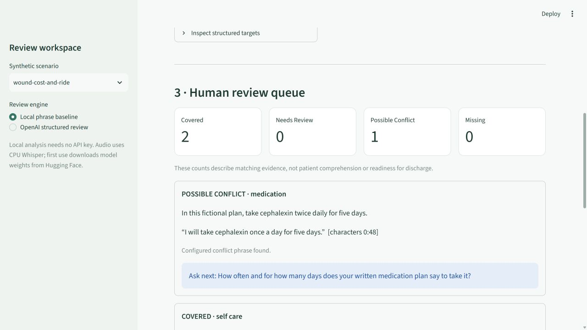
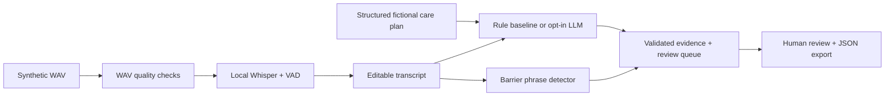

# CareEcho 🌱

**An evidence-linked discharge teach-back workbench, built for health literacy research.**

A patient explains their care plan in their own words. CareEcho transcribes a short
recording locally, compares the explanation with structured reference instructions,
and prepares a human review queue: what was mentioned, what needs clarification,
and what practical barriers may prevent follow-through.

The social focus is **access after discharge**: remembering instructions is only
part of the problem when someone cannot afford a prescription, has no ride, needs
an interpreter, or lives without support. CareEcho surfaces these statements with
their evidence and a question for the care team; it does not determine eligibility
for assistance or make clinical decisions.

> Research prototype using fictional cases. Not clinically validated, not a
> medical device, and not suitable for real patient data or patient care.



## What works

- **Local speech recognition:** Hugging Face-hosted Whisper weights through
  `faster-whisper`, CPU INT8 inference, VAD, timestamped segments, and optional vocabulary hints.
- **Audio processing:** PCM WAV validation, duration and clipping checks, low-level
  warnings, and a seeded noise experiment.
- **NLP baseline:** configurable concept groups, word-boundary matching, negation /
  uncertainty flags, conflict phrases, and social-barrier extraction.
- **Optional LLM API:** OpenAI Responses structured output, schema validation,
  exact-quote checks, target completeness checks, and explicit cloud opt-in.
- **Review interface:** Streamlit workbench, editable transcript, quote offsets,
  follow-up questions, and downloadable JSON.
- **Evaluation:** labeled synthetic cases, confusion matrix, macro F1, false
  coverage count, WER, vocabulary recall, and downstream status agreement.
- **Engineering:** installable Python package, CLI, automated tests, GitHub Actions,
  data provenance, and documented limitations.

The default path is a transparent rule baseline, not a trained clinical NLP model.
The actual pretrained model used is Whisper; no model fine-tuning is claimed.

## Quick start

Python 3.11 or 3.12 recommended. From the repository root:

```powershell
python -m venv .venv
.venv\Scripts\Activate.ps1
python -m pip install -e ".[app,asr,llm,dev]"
python -m streamlit run app.py
```

On macOS/Linux activate with `source .venv/bin/activate`. If PowerShell activation
is blocked, use `.venv\Scripts\python.exe` directly instead of changing policy.
Open `http://localhost:8501`. Select **wound-cost-and-ride**, then **Review teach-back**.
Try changing “once a day” to “twice daily” and rerun. The report changes while the
cost and transportation barriers remain visible.

After installation, Windows users can also launch with `powershell -File run.ps1`.
`requirements-tested.txt` records exact package versions from the verified Windows
environment; install with `python -m pip install -r requirements-tested.txt` when
reproducing that environment, followed by `python -m pip install -e .`.

Text-only CLI needs just `python -m pip install -e .`:

```bash
python -m careecho.cli review --plan data/plans/wound.json --transcript data/sample_transcript.txt
python -m careecho.cli evaluate --output outputs/evaluation.json
```

## Audio demo

The included `data/audio/teachback.wav` is synthetic Windows text-to-speech generated
from `data/sample_transcript.txt`. No real person or patient was recorded.

```bash
python -m careecho.cli transcribe data/audio/teachback.wav --model tiny.en --output outputs/transcription.json
python -m scripts.asr_experiment --model tiny.en --output outputs/asr_experiment.json
```

The first run downloads weights from Hugging Face. Later cached inference runs
locally. The prototype accepts **16-bit mono/stereo PCM WAV, 0.25–180 seconds,
up to 25 MB**, and forces English transcription. It does not support overlapping
speakers or diarization. `tiny.en` is a lightweight smoke-test default; `base.en`
and `small.en` are available options, not benchmarked superiority claims.

To regenerate the fixture on Windows:

```powershell
powershell -NoProfile -ExecutionPolicy Bypass -File scripts/make_demo_audio.ps1
```

## Optional LLM review

Set a key and a Responses-compatible model available to your account:

```powershell
$env:OPENAI_API_KEY = "your-key"
$env:OPENAI_MODEL = "your-supported-model-id"
python -m careecho.cli review --plan data/plans/wound.json --transcript data/sample_transcript.txt --engine openai --allow-cloud-synthetic
```

Or select OpenAI in the app and check the synthetic-data consent box. The cloud
request sends the **plan and transcript**, not the audio. `store=False` is requested;
this is not a promise of zero provider retention. `.env.example` documents variables;
the application does not auto-load `.env` files. Never commit a key.

Live API execution requires your credentials. Mocked API tests exercise the contract
but do not establish real model quality. Invalid or refused outputs fail closed;
the application does not silently substitute a successful-looking review.

## Architecture



The reference plan is explicitly authored JSON. CareEcho does not infer prescriptions
from a noisy recording, generate treatment instructions, or write to an EHR.
Follow-up questions come from the reference plan, including in LLM mode.

## Evaluation and tests

```bash
python -m pytest -q
python -m ruff check .
python -m careecho.cli evaluate --output outputs/evaluation.json
```

See [results](docs/RESULTS.md) and the raw [baseline report](reports/baseline.json).
This small authored set is a **diagnostic fixture**, not an independent test set.
Known failures remain in the report. Do not interpret its scores as clinical accuracy.

## Project map

| Path | Purpose |
|---|---|
| `app.py` | Local reviewer interface |
| `careecho/schema.py` | Typed input/output contracts |
| `careecho/nlp.py` | Evidence-linked NLP and barrier baseline |
| `careecho/audio.py` | Audio quality checks and local Whisper |
| `careecho/llm.py` | Optional structured API reviewer |
| `careecho/metrics.py`, `evaluate.py` | Evaluation and error analysis |
| `data/` | Fictional plans, labeled transcripts, synthetic audio |
| `scripts/` | Audio generation and ASR experiment |
| `tests/` | Core, audio, API-contract, and UI-flow tests |
| `docs/` | Results, data card, design, demo, and publishing guide |

## Research context

[AHRQ describes teach-back](https://www.ahrq.gov/teamstepps-program/curriculum/communication/tools/teachback.html)
as asking patients or caregivers to explain information in their own words. That
motivates this workflow; AHRQ has not evaluated or endorsed CareEcho.

Implementation references:
[faster-whisper](https://github.com/SYSTRAN/faster-whisper),
[Hugging Face model collection](https://huggingface.co/collections/Systran/faster-whisper),
and [OpenAI structured outputs](https://developers.openai.com/api/docs/guides/structured-outputs).

## Responsible scope and next steps

English-only, small synthetic corpus, hand-authored phrase coverage, uncalibrated
ASR scores, and no clinical or subgroup validation. Quotes can prove a sentence was
present, not that a model interpreted it correctly. See [design limitations](docs/DESIGN.md)
and [data card](docs/DATA_CARD.md).

Useful next experiments: independently annotated paraphrases, held-out speakers,
medical-term confusion sets, negation-scope modeling, reviewer adjudication, and
paired rule/LLM evaluation. Real clinical research would require an approved secure
environment and appropriate institutional processes before collecting any patient data.

See [the demo and study guide](docs/DEMO.md) before presenting the project and
[the GitHub guide](docs/PUBLISHING.md) for repository details. This scaffold was developed
with AI assistance; portfolio claims should reflect what you personally understand,
verify, and extend. License: MIT (third-party models retain their own licenses).
